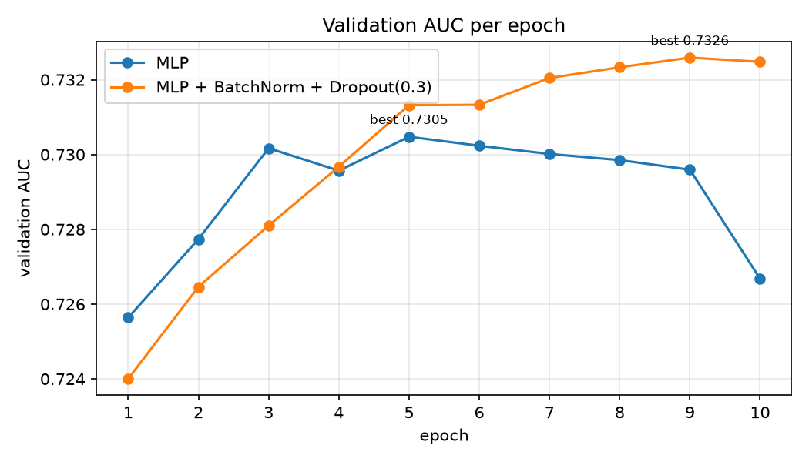

# 贷款违约预测：小土堆 PyTorch 教程的练手项目

天池比赛 [零基础入门金融风控—贷款违约预测](https://tianchi.aliyun.com/competition/entrance/531830/introduction)。

看完 [小土堆的 PyTorch 快速入门教程](https://www.bilibili.com/video/BV1hE411t7RN) 后，我想把视频里的训练套路用到一个真实比赛上。视频讲的是 CIFAR10 图片分类，这里换成表格数据的二分类：根据贷款人的信息，预测这个人会不会违约。

- 数据：训练集 80 万条，测试集 20 万条，47 个字段，违约率约 20%
- 评分：AUC
- 模型：PyTorch 写的 MLP，验证集 AUC **0.7326**

## 项目结构

### 比赛代码

| 文件 | 作用 | 对应视频 |
|---|---|---|
| `preprocess.py` | 字符串转数字、缺失值、异常值、one-hot、标准化 | Transforms |
| `dataset.py` | `LoanDataset`，一行贷款记录就是一个样本 | Dataset 类代码实战 |
| `model.py` | `LoanNet` 网络结构，训练和预测都从这里 import，避免写两份 | 搭建网络 |
| `train.py` | 训练 MLP，按验证集 AUC 保存最好的模型，用 TensorBoard 记录曲线 | 完整的模型训练套路 |
| `predict.py` | 加载模型，预测测试集，生成提交文件 | 完整的模型验证套路 |

### 学习材料

做的过程中写了一些辅助材料，放在仓库里方便回头查：

| 文件 | 作用 |
|---|---|
| `学习路线.md` | 视频内容和本项目的对照 |
| `preprocess拆解.ipynb` | 把 `preprocess.py` 拆成 15 步，每一步都先打印处理前、再打印处理后。打开就能看到已经跑好的输出 |
| `表格数据处理流程.md` | 拿到任意一张新表时的判断顺序：对每一列问 5 个问题判断它属于哪一类，再套对应手法。含「15 分钟速通版」写法，以及怎么判断一列有没有顺序 |
| `体检.py` | 拿到新表先跑它。逐列输出类型、缺失率、取值数、样例，并自动分类；还会扫出带空格的脏值、伪装成 `?` 的缺失值、常数列、完全重复的列、高缺失列 |
| `practice/` | 练手用：UCI Adult 数据集（收入预测，32561 行）。业务和贷款完全不同，用来检验这套处理流程是不是真的会了。**任务说明里没有答案** |

## 运行

数据文件太大，没有放进仓库，需要先去天池比赛页面下载 `train.csv` 和 `testA.csv`，放在项目根目录。

```bash
uv sync                               # 安装环境
uv run python preprocess.py           # 预处理，生成 data/processed.npz
uv run python train.py                # 训练，保存 model_best.pth
uv run python predict.py              # 生成 submission.csv
uv run tensorboard --logdir logs      # 查看训练曲线

uv run python 体检.py train.csv        # 拿到一张新表，先跑这个看里面有什么
```

练习数据（Adult）的用法：

```bash
uv run python 体检.py practice/adult.data --no-header --names-file practice/adult_列名.txt
```

## 实验结果

| 模型 | 最好的验证 AUC | 出现在第几轮 | 第 10 轮 AUC |
|---|---|---|---|
| MLP（118 → 256 → 128 → 2） | 0.7305 | 第 5 轮 | 0.7267 |
| MLP + BatchNorm1d + Dropout(0.3) | **0.7326** | 第 9 轮 | 0.7325 |

线上分数：待提交后补充



不加正则化的版本，第 5 轮之后验证 AUC 就开始往下走，训练 loss 却还在降，这是过拟合：模型开始记训练集里的偶然细节。加上 BatchNorm 和 Dropout 之后，最高分高了一点，后面几轮也基本没掉。

两个版本都只保存验证 AUC 最高的那一轮，所以后期下降不会影响最终用来预测的模型。

## 从图片分类到表格数据，我改了什么

- **不用卷积和池化。** 表格数据本来就是 `[batch, 118]`，一行一个样本，不用 Flatten，直接接 `Linear`。第一层的输入就是特征数 118。
- **输出改成 2 类。** 违约 / 不违约，对应视频里 CIFAR10 的 10 类。
- **指标从准确率换成 AUC。** 80% 的人不违约，模型全猜"不违约"准确率也有 80%，看不出好坏。AUC 看的是违约的人分数是不是普遍更高，全猜一样的分数只有 0.5。
- **AUC 不能按 batch 累加。** 准确率可以每个 batch 数对了几个再加起来，AUC 要把整个验证集排序才能算。所以要先把每个 batch 的概率存进列表，最后 `torch.cat` 拼起来一次算完。
- **用 softmax 取违约概率。** `torch.softmax(outputs, dim=1)[:, 1]` 取第 1 列。训练时不用手动加 softmax，`CrossEntropyLoss` 里面已经包含了。
- **设备用 `mps`。** 我用的是 M1 Mac，没有 NVIDIA 显卡，`torch.cuda.is_available()` 是 False，把视频里的 `"cuda"` 换成 `"mps"` 就能用 GPU。

## 踩过的坑

- `DataLoader(dataset=LoanDataset)` 传的是**类**，应该传用这个类建出来的**对象** `train_set`。优化器写成 `LoanNet.parameters()` 也是同一个错，应该是 `model.parameters()`。
- 验证时忘了 `with torch.no_grad()`，结果 tensor 带着梯度，传给 sklearn 时报错。
- `[: 1]` 少了个逗号，取到的是前 1 行，不是第 1 列。这个不会马上报错，到算 AUC 时才因为长度对不上报错。
- 往列表里加元素是 `.append()`，`.add()` 是集合的方法。
- `model.train()` 和 `model.eval()` 在视频里写不写结果都一样，因为视频的网络里没有 Dropout 和 BatchNorm。我的网络有这两层，就必须写对，否则验证时 Dropout 还在随机关神经元。
- TensorBoard 里训练 loss 抖得厉害，是因为每 100 步只记了当前那一个 batch 的 loss。可以改成记录这 100 步的平均值，或者在 TensorBoard 里把 Smoothing 调高。
- 预测时 DataLoader 的 `shuffle` 必须是 `False`，否则预测结果和 id 对不上。这种错不会报错，分数会直接掉到 0.5 左右。
- 预测脚本里不能 `from train import LoanNet`，import 会把 `train.py` 整个执行一遍，又训练 10 轮。所以后来把网络类单独拆进了 `model.py`。
- `full[["a", "b"]]` 和 `full["a", "b"]` 不是两种切法：前者的内层是**列表**，取两列；后者的逗号造出了一个**元组**，被当成一个列名，直接 `KeyError`。和 numpy 里 `[:, 8]` 能写、Python 列表里不能写是同一个道理。
- `.map(字典)` 里漏写了某个取值，**不会报错**，会静默变成 NaN。映射完要查一次 `isna().sum()` 确认没有意外变空。
- `train.csv` 有 175MB，超过 GitHub 单文件 100MB 的上限。之前已经提交进了历史，光加 `.gitignore` 不够，要先从历史里删掉。
- 练习用的 Adult 数据每个逗号后面都跟了个空格，导致缺失值 `?` 实际是 ` ?`，`.replace({"?": np.nan})` 替换不掉，而且不报错。**真实数据里脏值经常藏在看不见的地方。**

## 后续计划

- [x] 把 `LoanNet` 放进 `model.py`，训练和预测都从这里 import
- [x] 写一个把 `preprocess.py` 拆开的练习 notebook
- [ ] 做一遍 `practice/` 里的 Adult 练习（自己判断每一列怎么处理，不给答案）
- [ ] 训练 loss 改成记录平均值
- [ ] 跑一个 LightGBM 基线，和 MLP 对比
- [ ] K 折交叉验证
- [ ] 特征工程，目标是验证 AUC 到 0.74 以上
- [ ] 提交天池，把线上分数填进 README
